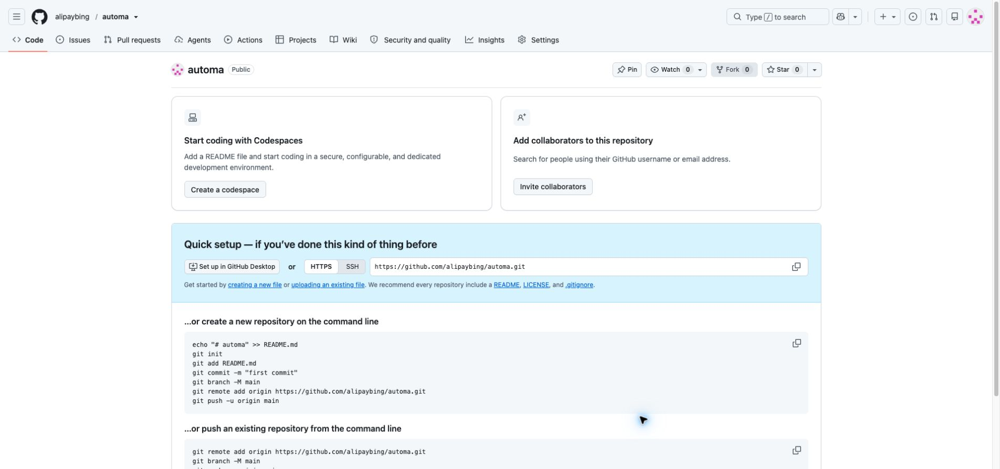

# 从安装 Automa 到导出小红书笔记

> 当前版本是操作说明草稿。已完成脚本静态检查，插件导入、实际采集和结果截图尚待用户协助完成，不将预期结果冒充实测结果。

## 1. 安装浏览器插件

用桌面版 Chrome 打开 [Automa 官方 Chrome 商店页面](https://chromewebstore.google.com/detail/automa/infppggnoaenmfagbfknfkancpbljcca)，选择「添加至 Chrome」，核对提示后完成安装。从浏览器扩展菜单打开 Automa。

本次环境已安装 Automa，不需要卸载重装。安装页面和安装完成状态截图待补。

## 2. 下载并导入工作流

打开 [GitHub 仓库](https://github.com/alipaybing/automa)，下载根目录的 `red_note_v5.json`。如点击文件进入预览，请使用原始文件下载入口，确保保存的是 JSON 内容。

在 Automa 工作流列表找到导入入口，选择该文件。导入后工作流名称为 `rednote_v5_多关键词`。脚本记录的导出扩展版本为 `1.30.02`；不同版本界面位置可能不同。

导入与流程图截图待补。

## 3. 登录小红书并设置少量参数

先在同一个 Chrome 用户配置中登录 [小红书网页版](https://www.xiaohongshu.com/explore)。手动搜索测试关键词，确认可以打开一篇笔记。

运行导入的工作流，在参数中填写：

| 参数 | 首次示例 |
| --- | --- |
| 关键词 | 桌面收纳 |
| 每个关键词篇数 | 3 |

请将原始默认的 30 篇调成 3。首次只填一个关键词；测试成功后可使用 `桌面收纳,书桌整理` 这样的多关键词输入。

参数设置截图待补。

## 4. 执行与观察

启动后，工作流会打开小红书，逐词进入搜索页，尝试选择「最新」，滚动收集笔记链接，按笔记 ID 去重，再打开每篇笔记读取内容。

筛选节点允许失败后继续，因此页面结构变化时不能保证最终按「最新」排序。运行时保留浏览器窗口，避免手动关闭流程正在使用的标签页。遇到登录或验证页面，先停止流程，手动处理后再运行。

运行中的网页和 Automa 日志截图待补。若出现失败，教程应记录真实错误与修复过程。

## 5. 查看导出结果

正常结束后，工作流配置会下载：

- `red_note.json`：关键词、标题、图片链接、正文、时间、评论区域文本和笔记链接。
- `red_note_links.json`：链接清单，元素包含 `id`、`kw`、`url`。

检查浏览器下载记录与实际文件。确认笔记数量不超过本次设置，标题和正文不是全空，链接能对应已打开的笔记。不要只根据流程显示结束就判定采集成功。

导出节点的同名文件策略为覆盖，重复运行前请先保存上一份结果。评论只包括已加载的区域，图片字段只取选择器匹配的当前图片；不要将结果理解为完整笔记媒体或全部评论。

实际导出文件、数量检查和结果预览截图待补。

## 6. 常见问题

| 现象 | 检查方向 |
| --- | --- |
| 找不到导入后的流程 | 核对下载的是 JSON 原文，并检查当前 Automa 配置 |
| 采集链接为零 | 查看小红书登录状态、搜索结果是否可见、页面选择器是否变化 |
| 标题或正文为空 | 检查是否打开正文页、是否存在验证提示、页面加载是否完成 |
| 评论为空或不全 | 评论可能未加载；当前流程没有保证滚动读取全部评论 |
| 没有下载文件 | 检查流程是否运行到两个导出节点，以及浏览器下载记录 |

## 本次实际完成情况

- 码云完整备份：`backup/all-workflows-2026-10-28`，提交 `0a37ff5ea5c18156343eb0afa7aa4a2719489c2f`。
- 已创建 GitHub 公开仓库，下面截图是上传前的创建成功状态。
- 插件内操作被浏览器安全策略阻止，3 篇运行与结果验证尚未完成。

